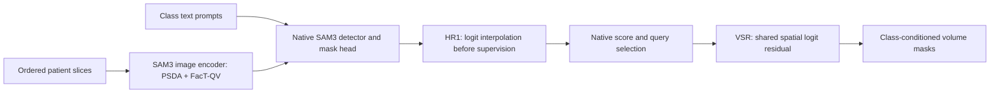

# MedSpaDA

Spatial-depth adaptation of SAM3 for text-prompted medical volume segmentation.

This repository contains the current model components and a portable training,
evaluation, and inference interface. Each text prompt requests a foreground
class. The model processes consecutive slices from one patient, uses visual
cross-slice adaptation, and reconstructs a complete volume for evaluation.

## Model



- **Hybrid spatial-depth adaptation:** two adapters in every visual transformer
  block, with parallel in-plane filtering and through-plane convolution.
  Shared rank-32 FacT factors update visual attention Q/V projections.
- **Fixed resolution path:** native mask logits are interpolated through
  504 to 1008 pixels before loss computation. This adds no learned upsampler.
- **Volume-supervised refinement (VSR):** a shared 2D residual network refines
  the selected mask. Its training loss includes consistency over the supervised
  slice window. It preserves the base acceptance decision.

The current method uses an identity query path: it does **not** add learned
query memory, a video tracker, or a CLS-token fusion branch.

## Installation

Use Python 3.10+ and a CUDA-enabled PyTorch installation. Obtain SAM3 code and
weights separately under its license. See [installation](docs/installation.md)
for the pinned upstream commit, required patch, and dependencies.

```bash
git clone https://github.com/ivel-Li/MedSpaDA.git
cd MedSpaDA
pip install -e .
```

## Data

The loader accepts a JSON manifest and preprocessed NPZ volumes. Each volume
contains `images` (`uint8 [D,H,W,3]`), `label` (integer `[D,H,W]`), and ordered
physical slice coordinates `z_mm` (`float [D]`). Manifests provide task-specific
class prompts and patient-disjoint train/dev/test identities.

```bash
python scripts/validate_data.py --manifest data/manifest.json --check-arrays
```

See [the data format](docs/data.md). A tiny, entirely synthetic loader example
can be generated without any medical data:

```bash
python scripts/make_synthetic_data.py --output-dir data/synthetic
python scripts/validate_data.py --manifest data/synthetic/manifest.json --check-arrays
```

## Training

```bash
python scripts/train.py \
  --config configs/medspada.yaml \
  --manifest data/manifest.json \
  --sam3-repo external/sam3 \
  --sam3-checkpoint weights/sam3.pt \
  --gpu 0 --output-dir runs/medspada
```

The default recipe uses 20 base epochs followed by 10 epochs of **joint
base/VSR training**. Every epoch evaluates all dev cases. One checkpoint is
selected by equal-dataset mean case-volume Dice, then evaluated on the complete
test split. Re-running the same command resumes verified epoch checkpoints.

Use `--smoke` with a separate output directory to check ten real training
windows before a full run. It does not access test labels or initialize a
formal run from smoke weights. The fixed training canvas is 1008 pixels; the
memory requirement depends strongly on the active concepts and native volume
geometry. See [the method and training protocol](docs/method.md).

| Configuration | Visual adaptation | HR1 | VSR |
| --- | --- | --- | --- |
| `medspada.yaml` | Parallel PSDA + FacT-QV | Yes | Joint stage |
| `medspada_serial.yaml` | Serial spatial/depth + FacT-QV | Yes | Joint stage |
| `without_A.yaml` | Full visual fine-tuning | Yes | Joint stage |
| `without_VSR.yaml` | Parallel PSDA + FacT-QV | Yes | No |
| `sam3_ft.yaml` | Full SAM3 fine-tuning | Original SAM3 path | No |

## Evaluation and inference

```bash
python scripts/evaluate.py \
  --manifest data/manifest.json \
  --sam3-repo external/sam3 --sam3-checkpoint weights/sam3.pt \
  --checkpoint runs/medspada/joint10/checkpoint_best.pt \
  --split test --output runs/medspada/test.json --gpu 0

python scripts/infer.py \
  --manifest data/manifest.json \
  --sam3-repo external/sam3 --sam3-checkpoint weights/sam3.pt \
  --checkpoint runs/medspada/joint10/checkpoint_best.pt \
  --input data/new_volume.npz --prompts "liver" "spleen" \
  --output runs/prediction.npz --gpu 0
```

Inference reads only images and slice coordinates from the input NPZ; a label
array is not needed. Outputs are independent binary masks `[C,D,H,W]`, prompt
strings, and `z_mm`. The provided manifest defines the training/evaluation
ontology; inference is text-only and uses no GT, points, or boxes as prompts.

## Repository layout

```text
medspada/       Model components, patient runner, portable data and training code
configs/        Main method, SAM3 FT, and controlled component configurations
scripts/        Training, evaluation, inference, and data validation entry points
tests/          CPU tests for model behavior, split integrity, metrics, and CLIs
patches/        Minimal patch against the pinned SAM3 source
docs/           Installation, data schema, and method documentation
.github/        CPU test workflow
```

## Release scope

This is a source-code release. It contains no medical images, patient lists,
trained checkpoints, experiment output, or unpublished benchmark tables.
Dataset-specific preprocessing and legally obtained data remain the user's
responsibility. The manifest loader is a portable interface, not a bundle of
the development environment's dataset paths or frozen patient lists.

CPU tests cover the released components and data/CLI contracts. The source is
derived from the active training implementation; a fresh full GPU benchmark
using the portable NPZ interface is not claimed as part of this release.

## License and attribution

This SAM3-derived implementation is distributed under the [SAM License](LICENSE).
SAM3 code and weights retain their upstream terms. See
[THIRD_PARTY_NOTICES.md](THIRD_PARTY_NOTICES.md) for the SAM3, Mona, and FacT
references and the scope of adaptation. Software citation metadata is provided
in [CITATION.cff](CITATION.cff).
